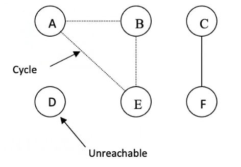
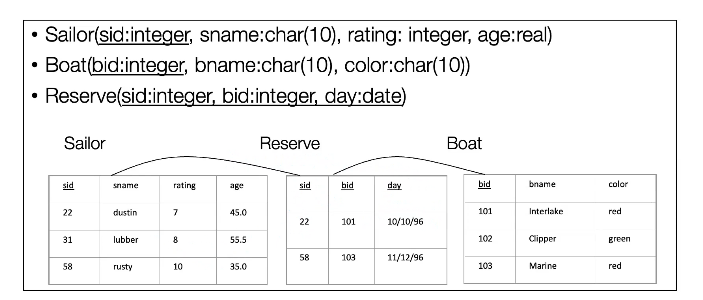
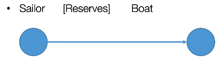

## Some graph theory

Graph databases are based on graph theory, so let’s start with a few basics. A **path** follows edges from one vertex to another. A **simple path** visits each vertex at most once, while a **cycle** comes back to its starting vertex without repeating the other vertices.



In this example, you can reach E from A, but you cannot reach D from A. An undirected graph is **connected** if every pair of vertices is joined by a path. A directed graph is **strongly connected** if you can get from every vertex to every other vertex while following the edge directions.

We can also talk about **sparse** and **dense** graphs. A graph with roughly as many edges as vertices is sparse. A graph with close to the maximum possible number of edges is dense; in a simple graph, that maximum grows quadratically with the number of vertices.

Finally, a **subgraph** uses a subset of the original graph’s vertices and edges. If we keep an edge, we also have to keep both of its endpoints.

## Thinking about a graph as a database

How can we think of a graph as a database? Where is the data? In a **property graph**, nodes represent entities and relationships connect them. Both can carry properties. A relationship might store a numeric weight, but it could just as well store a date.

So why use a graph database? Because relational databases are bad at relationships, obviously. (Yes, that’s a joke.) In a relational model, following a chain of relationships can mean joining several tables. A graph database stores relationships explicitly, so it can traverse them directly from a starting node. That can be useful for queries that follow several links. How fast either approach is depends on the query and the data.

How do we ask a graph database a question? We give it a **pattern** and ask for matches. The database can use an index to find a starting point and then follow the relationships in the pattern.

Take sailors and boats as an example. In the relational model, a reservation sits in a separate table, with IDs linking it to a sailor and a boat:



In the graph model, the reservation is a relationship from a sailor to a boat. The reservation date can be a property of that relationship.



## Neo4j

Neo4j is the graph database we’ll look at here. Its Community Edition is open source, and it runs on the Java Virtual Machine. I found the choice of Java a little surprising. I haven’t looked into why they chose it yet, but I will.

Neo4j has a flexible schema: you can start adding nodes and relationships without defining every property in advance. You can still enforce rules with constraints. Its transactions are **ACID**, which means, among other things, that a transaction’s changes succeed or fail together.

To query the database, we use **Cypher**. I love the Matrix reference. Cypher is declarative, like SQL: you describe the data you want, and the database decides how to find it.

Let’s look at some of the syntax.

### Data creation

Suppose we already have a node for Sergey Brin. We want to create a node for Larry Page and connect it to Brin with a `KNOWS` relationship. In `(page:Founder {name: 'Larry Page'})`, `Founder` is a label, `name` is a property, and `page` is the variable we use to refer to the node within the query.

You might first try to create Page and then write the relationship pattern separately:

```cypher
CREATE (page:Founder {name: 'Larry Page'})
(page)-[:KNOWS]->(brin)
```

There are two things missing here. The relationship pattern needs to be part of a clause, and we haven’t matched the existing Brin node. Here’s the corrected version:

```cypher
MATCH (brin:Founder {name: 'Sergey Brin'})
CREATE (page:Founder {name: 'Larry Page'})-[:KNOWS]->(brin)
```

We can also give a node more than one label:

```cypher
CREATE (page:Founder:SWDeveloper {name: 'Larry Page'})
```

There’s something to watch out for: if we run that last `CREATE` 1,000 times, we create 1,000 nodes. If we want to match an existing node or create it when there’s no match, we can use `MERGE`:

```cypher
MERGE (jim:Founder {name: 'Jim Simons'})
ON CREATE SET jim.company = 'Renaissance Technologies'
```

`MERGE` looks for a `Founder` with that name and creates one if it finds no match. `ON CREATE SET` assigns the company only when a new node is created.

### Constraints

Even with a flexible schema, we can set rules for our data. For example, we can require the `name` property to be unique among `Founder` nodes that have it:

```cypher
CREATE CONSTRAINT founder_name_unique IF NOT EXISTS
FOR (f:Founder)
REQUIRE f.name IS UNIQUE
```

We can also create indexes to speed up lookups. One use is to help Neo4j find the starting nodes for a query:

```cypher
CREATE INDEX founder_id_index IF NOT EXISTS
FOR (f:Founder)
ON (f.founderID)
```

This index can help when we search by `founderID`. The useful index is the one that matches what we actually search for.

### Queries

A basic Cypher query often has three parts: `MATCH` describes the pattern, `WHERE` filters the matches, and `RETURN` tells the database what to give back.

Let’s start with an example:

```cypher
MATCH (n:Founder)-[r:KNOWS]-(m)
WHERE n.name = 'Larry Page'
RETURN n AS page, r, m
```

We’re looking for a founder named Larry Page who is connected to another node by a `KNOWS` relationship. The other node doesn’t have to be a founder. The query returns Page, the relationship, and the other node. There’s no arrow in the pattern, so it can match a relationship in either direction.

Let’s go a little deeper:

```cypher
MATCH p = (n:Founder)-[:KNOWS*]-(m)
WHERE n.name = 'Larry Page'
RETURN n AS page, relationships(p) AS r, m
```

The `*` allows the pattern to follow one or more `KNOWS` relationships. If Page knows John and John knows Bob, the query can return the path from Page to John and the longer one from Page through John to Bob. The variable `p` holds the path, and `relationships(p)` gives us its list of relationships.

There are a few other ways to write a pattern:

- `(n)-[:KNOWS]->(m)` follows a relationship from `n` to `m`, while `(n)-[:KNOWS]-(m)` allows either direction.
- `(n)-[:KNOWS|LOVES]->(m)` accepts either relationship type. You can read `|` as “or.”

We can order the results with `ORDER BY` and restrict the number of rows with `LIMIT`. For example:

```cypher
MATCH (f:Founder)
RETURN f.name AS name, f.founderID AS founderID
ORDER BY founderID DESC
LIMIT 10
```

We can also ask for each destination only once, even if several paths reach it:

```cypher
MATCH (n:Founder)-[:KNOWS*]-(m)
WHERE n.name = 'Larry Page'
RETURN DISTINCT m
```

Or we can use `count()` to find out how many distinct destinations there are:

```cypher
MATCH (n:Founder)-[:KNOWS*]-(m)
WHERE n.name = 'Larry Page'
RETURN count(DISTINCT m) AS reachableNodes
```

What if we only want to follow a limited number of relationships? This pattern matches paths of one to three hops:

```cypher
MATCH (n:Founder)-[*1..3]-(m)
WHERE n.name = 'Larry Page'
RETURN DISTINCT m
```

You can omit the upper bound to allow any length above the minimum, as in `[*2..]`. If you omit the lower bound, as in `[*..3]`, the minimum defaults to one hop.

We can also find a shortest path with a dedicated function:

```cypher
MATCH p = shortestPath(
  (n:Founder {name: 'Larry Page'})-[:KNOWS*]-
  (m:Founder {name: 'Elon Musk'})
)
RETURN p
```

If there’s a match, `p` contains the whole path, including the start and end nodes. Here, shortest means using the fewest relationships. I’ll come back to how Neo4j finds that path at the end of the article.

What if we want every relationship on the path to meet a condition? We can use `relationships(p)` to get the relationships and `all()` to test each of them. In this example, every `KNOWS` relationship on the path must have a `years` value greater than five:

```cypher
MATCH p = shortestPath(
  (n:Founder {name: 'Larry Page'})-[:KNOWS*]-
  (m:Founder {name: 'Elon Musk'})
)
WHERE all(r IN relationships(p) WHERE r.years > 5)
RETURN p
```

While you’re learning, try putting `PROFILE` before a read query. It runs the query and shows its execution plan, which makes it easier to see what Neo4j actually did.

### How to handle null values

As in relational databases, missing values need a little care. It’s tempting to compare a property directly with `null`:

```cypher
MATCH (n:Founder)-[:KNOWS*]-(m)
WHERE n.name = 'Larry Page' AND m.name <> null
RETURN DISTINCT m
```

That doesn’t work as intended. Comparing a value with `null` yields `null`, so the condition never passes the `WHERE` filter. Cypher uses `<>` for inequality, but to check whether a value is present, use `IS NOT NULL`:

```cypher
MATCH (n:Founder)-[:KNOWS*]-(m)
WHERE n.name = 'Larry Page' AND m.name IS NOT NULL
RETURN DISTINCT m
```

### Delete

We can also delete nodes and relationships. For example, this query tries to delete every node:

```cypher
MATCH (n)
DELETE n
```

Neo4j rejects the deletion if a node still has relationships. To delete a node together with its relationships, use `DETACH DELETE`. Run this example only on a disposable database: it deletes the entire graph.

```cypher
MATCH (n)
DETACH DELETE n
```

### Multistep queries

I like to think of `WITH` as a checkpoint. The variables and expressions you pass through it are available in the next part of the query. Anything you leave out goes out of scope.

This is easier to see with an example. Let’s find founders who know at least ten different people:

```cypher
MATCH (n:Founder)-[:KNOWS]->(m)
WITH n, count(DISTINCT m) AS knownPeople
WHERE knownPeople >= 10
RETURN n, knownPeople
```

The first step finds the matches. `WITH` groups them by founder and counts the distinct people each founder knows. The next step filters those counts.

## How is Neo4j implemented?


This diagram shows the broad layers: data files and transaction logs live on disk, the operating system manages access to the files, and Neo4j runs on the JVM.

The idea I find interesting is that we can distinguish the **topology** of the graph, which tells us which nodes are connected, from the properties attached to those nodes and relationships. The diagram shows an older record layout with separate files. The exact layout depends on the [store format](https://neo4j.com/docs/operations-manual/current/database-internals/store-formats/).

When a query needs stored data, Neo4j can read pages already held in its [page cache](https://neo4j.com/docs/operations-manual/current/performance/disks-ram-and-other-tips/). If a page isn’t cached, it has to be loaded from storage. Keeping frequently accessed pages in memory helps avoid repeated disk reads.

## Some exercises and their solutions

Open [Neo4j Sandbox](https://sandbox.neo4j.com/), sign in, and launch the **Movies** example dataset. First, explore the graph to see which labels, relationship types, and properties it contains. Then try these queries.

### Exercises

1. List the title and release year of every movie released from 2000 to 2005, inclusive. Show the most recent first and sort movies from the same year alphabetically.
2. Find the five oldest people whose birth year is known. Return their names and birth years, breaking ties by name.
3. In a single row, return the total number of people and the number with a known birth year.
4. Which movies were released in the same year as *The Matrix*? Exclude *The Matrix* itself.
5. For every year with at least three releases, return the year and the number of movies. Sort by the number of movies, highest first, then by year.
6. Return a single row with one column, `classics`: the list of movie titles released before 1990, ordered by release year and then by title.
7. Return Keanu Reeves’ filmography as an actor: title, release year, and the roles he played. Sort chronologically, breaking ties by title.
8. Without knowing the relationship types in advance, find every type of relationship Tom Hanks has, in either direction, and count how many of each he has.
9. Find the people who directed a movie in which they also acted. Return the person and the movie.
10. Which movies have more than one director? Return each title and its list of directors, sorted by movie title.
11. Return the five movies with the largest casts and the number of actors in each. Break ties by title.
12. How many people in the database have never acted in a movie?
13. List the actors who acted in at least five movies and the number of movies each acted in. Show the most prolific first, breaking ties by name.
14. Find the people who produced, directed, and wrote the same movie. Return the person and the movie.
15. Find Keanu Reeves’ five most frequent co-actors and the number of movies he shared with each. Break ties by name.
16. Consider all the movies Tom Hanks acted in. How many distinct people are connected to those movies by any relationship, excluding Tom Hanks? In the same row, return the total number of those relationships. Then remove the condition that excludes Tom Hanks. What changes, and why?
17. Which movies did Jessica Thompson review that James Thompson did not? Return the title and Jessica’s rating, highest first.
18. Find the movie with the most incoming relationships from people. In the same query, break down that total by relationship type for that movie only.
19. Find the actors who acted in at least three movies released in the 1990s. Return the actor, the count, and the list of titles. Show the most active first, breaking ties by name.

### Solutions

#### 1. Movies released from 2000 to 2005

```cypher
MATCH (m:Movie)
WHERE m.released >= 2000 AND m.released <= 2005
RETURN m.title AS title, m.released AS year
ORDER BY year DESC, title ASC
```

#### 2. The five oldest people

```cypher
MATCH (p:Person)
WHERE p.born IS NOT NULL
RETURN p.name AS name, p.born AS birthYear
ORDER BY birthYear, name
LIMIT 5
```

#### 3. People with a known birth year

```cypher
MATCH (p:Person)
RETURN count(p) AS totalPeople, count(p.born) AS knownBirthYears
```

The trick here is that `count(p.born)` skips missing values, while `count(p)` counts every matched person.

#### 4. Movies from the same year as The Matrix

```cypher
MATCH (matrix:Movie {title: 'The Matrix'})
MATCH (m:Movie)
WHERE m.released = matrix.released AND m <> matrix
RETURN m.title AS title
```

#### 5. Years with at least three releases

```cypher
MATCH (m:Movie)
WHERE m.released IS NOT NULL
WITH m.released AS year, count(m) AS movies
WHERE movies >= 3
RETURN year, movies
ORDER BY movies DESC, year ASC
```

#### 6. Classics in release order

```cypher
MATCH (m:Movie)
WHERE m.released < 1990
WITH m
ORDER BY m.released, m.title
RETURN collect(m.title) AS classics
```

#### 7. Keanu Reeves’ filmography

```cypher
MATCH (:Person {name: 'Keanu Reeves'})-[act:ACTED_IN]->(m:Movie)
RETURN m.title AS title, m.released AS year, act.roles AS roles
ORDER BY year, title
```

#### 8. Tom Hanks’ relationship types

```cypher
MATCH (:Person {name: 'Tom Hanks'})-[r]-()
RETURN type(r) AS relationship, count(r) AS howMany
ORDER BY howMany DESC, relationship
```

#### 9. People who acted in a movie they directed

```cypher
MATCH (p:Person)-[:ACTED_IN]->(m:Movie)<-[:DIRECTED]-(p)
RETURN DISTINCT p.name AS person, m.title AS movie
```

#### 10. Movies with more than one director

```cypher
MATCH (p:Person)-[:DIRECTED]->(m:Movie)
WITH m, collect(DISTINCT p) AS directors
WHERE size(directors) > 1
RETURN m.title AS title, [p IN directors | p.name] AS directors
ORDER BY title
```

#### 11. The five largest casts

```cypher
MATCH (m:Movie)
OPTIONAL MATCH (m)<-[:ACTED_IN]-(a:Person)
WITH m, count(DISTINCT a) AS castSize
RETURN m.title AS title, castSize
ORDER BY castSize DESC, title
LIMIT 5
```

#### 12. People who have never acted in a movie

```cypher
MATCH (p:Person)
WHERE NOT EXISTS {
  MATCH (p)-[:ACTED_IN]->(:Movie)
}
RETURN count(p) AS peopleWhoNeverActed
```

#### 13. Actors with at least five movies

```cypher
MATCH (a:Person)-[:ACTED_IN]->(m:Movie)
WITH a, count(DISTINCT m) AS movies
WHERE movies >= 5
RETURN a.name AS name, movies
ORDER BY movies DESC, name
```

#### 14. People who produced, directed, and wrote the same movie

```cypher
MATCH (p:Person)-[:PRODUCED]->(m:Movie)<-[:DIRECTED]-(p),
      (p)-[:WROTE]->(m)
RETURN DISTINCT p.name AS person, m.title AS movie
```

#### 15. Keanu Reeves’ most frequent co-actors

```cypher
MATCH (keanu:Person {name: 'Keanu Reeves'})-[:ACTED_IN]->(m:Movie)
      <-[:ACTED_IN]-(co:Person)
WHERE co <> keanu
WITH co, count(DISTINCT m) AS sharedMovies
RETURN co.name AS coActor, sharedMovies
ORDER BY sharedMovies DESC, coActor
LIMIT 5
```

#### 16. People and relationships connected to Tom Hanks’ movies

```cypher
MATCH (tom:Person {name: 'Tom Hanks'})-[:ACTED_IN]->(m:Movie)
WITH DISTINCT tom, m
MATCH (m)-[r]-(p:Person)
WHERE p <> tom
RETURN count(DISTINCT p) AS totalPeople, count(r) AS totalRelationships
```

Remove `WHERE p <> tom` and the people count goes up by one: Tom Hanks is included. The relationship count goes up by the number of his links to those movies. One person can account for several relationships.

#### 17. Movies reviewed by Jessica Thompson but not James Thompson

```cypher
MATCH (:Person {name: 'Jessica Thompson'})-[r:REVIEWED]->(m:Movie)
WHERE NOT EXISTS {
  MATCH (:Person {name: 'James Thompson'})-[:REVIEWED]->(m)
}
RETURN m.title AS title, r.rating AS rating
ORDER BY rating DESC
```

#### 18. The movie with the most incoming relationships

```cypher
MATCH (m:Movie)<-[r]-(:Person)
WITH m, count(r) AS total
ORDER BY total DESC, m.title
LIMIT 1
MATCH (m)<-[r]-(:Person)
RETURN m.title AS movie, total, type(r) AS relationship, count(r) AS howMany
ORDER BY howMany DESC, relationship
```

#### 19. Actors with at least three movies from the 1990s

```cypher
MATCH (p:Person)-[:ACTED_IN]->(m:Movie)
WHERE m.released >= 1990 AND m.released <= 1999
WITH DISTINCT p, m
ORDER BY m.released, m.title
WITH p, count(m) AS movies, collect(m.title) AS titles
WHERE movies >= 3
RETURN p.name AS actor, movies, titles
ORDER BY movies DESC, actor
```

## Shortest path deep dive

For the `shortestPath()` queries we saw earlier, the condition on the path can change how Neo4j searches. If it can check a condition as it goes, such as requiring every node on the path to have the `Founder` label, it can discard invalid paths early. A bidirectional breadth-first search starts from both ends, expanding one hop at a time.

Now suppose we require at least one node on the path to have `net_worth = 10000000`. Seeing a node without that value doesn’t tell us whether the path is invalid: a later node might satisfy the condition. If the fast search cannot find a valid path, Neo4j may fall back to a slower exhaustive depth-first search. The [Cypher manual’s shortest-path section](https://neo4j.com/docs/cypher-manual/current/patterns/shortest-paths/) explains when this happens.

