Let’s start with a quick guide to itemset mining. I’ll try to keep it quick, at least. This is the first post in my series revisiting [*Data Mining and Machine Learning*](https://dataminingbook.info/) by Mohammed J. Zaki and Wagner Meira, Jr.

## What is an itemset?

Itemset mining looks for groups of items that frequently occur together. We can use these groups to generate **association rules**. The classic example is market basket analysis, where we might discover a rule like “Customers who buy milk and cereal also tend to buy bananas.”

Let $I=\{x_1,x_2,\ldots,x_m\}$ be the set of all items. An **itemset** is any subset $X\subseteq I$. A **transaction** is a pair $\langle t,i(t)\rangle$, where $t$ is its unique ID and $i(t)$ is the itemset it contains.

We can represent the same database $D$ in three ways:

- **Binary:** each row is a transaction and each column is an item. A $1$ means that the item is present, and a $0$ means it is absent.
- **Transactional:** each transaction ID maps to the items in that transaction.
- **Vertical:** each item maps to the IDs of the transactions that contain it. This list of IDs is called a **tidset**.

Here’s the same database in all three forms. You can read a row to find the items in one transaction, or read down a column to find the transactions containing one item. For example, $t(A)=\{1,3,4,5\}$.

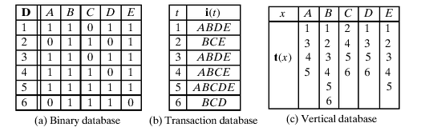

I’ll use `AB` as shorthand for the itemset $\{A,B\}$. The order of the letters does not matter.

## Support

The **support** of $X$ is the number of transactions that contain all of its items. If $t(X)$ is the set of IDs of those transactions, then:

$$
\operatorname{sup}(X)=|t(X)|,
\qquad
t(X)=\{t:\langle t,i(t)\rangle\in D,\ X\subseteq i(t)\}.
$$

The **relative support** is the fraction of transactions containing $X$:

$$
\operatorname{rsup}(X)=\frac{\operatorname{sup}(X)}{|D|}.
$$

An itemset is **frequent** if its support is at least the minimum support threshold, $\operatorname{minsup}$.

## Association rules

An **association rule** has the form $X\Rightarrow Y$, where $X$ and $Y$ are nonempty, disjoint itemsets. We call $X$ the **antecedent** and $Y$ the **consequent**.

### Support of a rule

The support of $X\Rightarrow Y$ counts transactions that contain both sides:

$$
\operatorname{sup}(X\Rightarrow Y)
=\operatorname{sup}(X\cup Y)
=|t(X\cup Y)|.
$$

### Confidence of a rule

**Confidence** answers a different question: of the transactions that contain $X$, what fraction also contain $Y$?

$$
\operatorname{conf}(X\Rightarrow Y)
=\frac{\operatorname{sup}(X\cup Y)}{\operatorname{sup}(X)}.
$$

We call a rule frequent if it meets the minimum support threshold and confident if it meets the minimum confidence threshold.

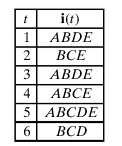

Let’s try the rule $\{B,C\}\Rightarrow\{E\}$ on our database. Transactions $2$, $4$, and $5$ contain `BCE`, so the rule has support $3$. Transaction $6$ contains `BC` but lacks `E`. In total, there are four transactions containing `BC`, which gives us:

$$
\operatorname{conf}(\{B,C\}\Rightarrow\{E\})=\frac34=0.75.
$$

## Rule mining

We want rules that meet both thresholds. The first step is to find the frequent itemsets and record their supports. Then, for each frequent itemset $Z$, we look for rules whose two sides together make up $Z$. The supports we computed in the first step give us the numerator and denominator for each rule’s confidence.

Let’s go step by step and start with the search for frequent itemsets.

### Find frequent itemsets

#### Brute-force algorithm

If you’ve studied computer science, you probably know what comes next. Brute force is the easiest place to start: try every subset of $I$, count its support, and keep it if it is frequent.

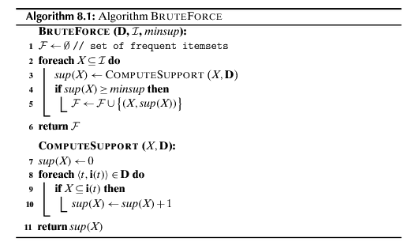

The subsets form a **lattice**: starting from the empty set, each edge down adds one item.

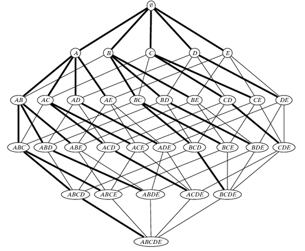

There are $2^{\lvert I\rvert}$ subsets, including the empty set. With a binary representation, checking whether a transaction contains a candidate takes at most $O(\lvert I\rvert)$ time. We repeat this check for all $\lvert D\rvert$ transactions for each candidate, so the brute-force time bound is:

$$
O\bigl(\lvert I\rvert \cdot \lvert D\rvert \cdot 2^{\lvert I\rvert}\bigr).
$$

The three factors come from checking items, scanning transactions, and enumerating candidates, respectively.

### Apriori algorithm

Brute force counts the support of every candidate. Can we skip candidates that have no chance of being frequent? Yes, thanks to one property:

$$
X\subseteq Y\quad\Longrightarrow\quad
\operatorname{sup}(X)\geq\operatorname{sup}(Y).
$$

Any transaction that contains $Y$ also contains $X$. So if $X$ is already infrequent, all its supersets are infrequent too. **Apriori** uses this property to prune the search breadth first, one itemset size at a time.

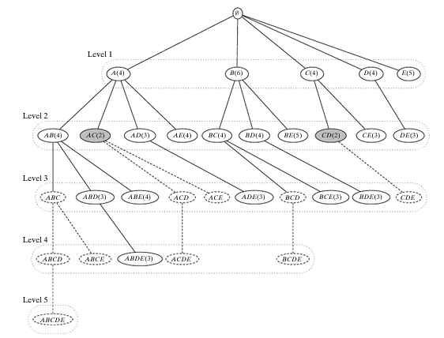

1. Start with the individual items as the candidates $C^{(1)}$.
2. At level $k$, count the support of each candidate in $C^{(k)}$. Keep the frequent ones in $F^{(k)}$.
3. Join frequent $k$-itemsets with the same first $k-1$ items, using a fixed item order. This gives potential $(k+1)$-itemsets.
4. Discard any candidate with an infrequent $k$-item subset. The remaining candidates form $C^{(k+1)}$. Repeat until no candidates remain.

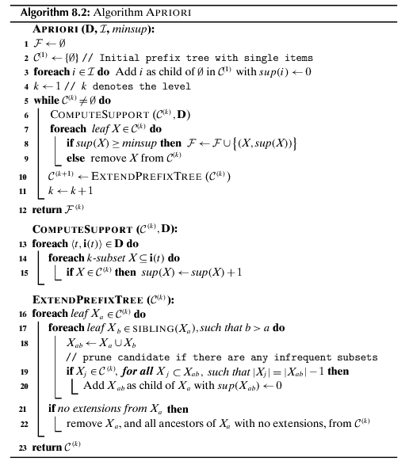

With $\operatorname{minsup}=3$, `AC` has support $2$. We can therefore rule out `ABC` without counting it. The dashed branches in the tree show parts of the search space ruled out by pruning. For a candidate that does reach the join step, consider `BCD`: joining `BC` and `BD` gives `BCD`, but `CD` is infrequent, so we discard it before counting. The worst case is still exponential, since there’s nothing to prune if every itemset is frequent.

### Eclat algorithm

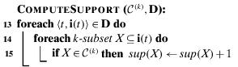

One way to count support in Apriori is to scan each transaction, generate its $k$-item subsets, and check which ones belong to $C^{(k)}$. That can get expensive. **Eclat** takes advantage of the vertical representation instead.

If $t(X)$ and $t(Y)$ tell us which transactions contain $X$ and $Y$, then:

$$
t(X\cup Y)=t(X)\cap t(Y),
\qquad
\operatorname{sup}(X\cup Y)=|t(X)\cap t(Y)|.
$$

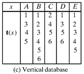

For example, $t(A)=\{1,3,4,5\}$ and $t(D)=\{1,3,5,6\}$, so $t(AD)=\{1,3,5\}$ and $\operatorname{sup}(AD)=3$. Notice that we didn’t have to scan the original database again. We used two tidsets we already had.

Eclat starts with the tidsets of frequent individual items. It combines pairs of extensions of the same prefix, intersects their tidsets, and keeps the result if it is frequent. It then explores each surviving branch **depth first**.

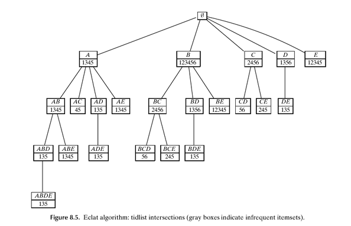

Let’s walk through the example with $\operatorname{minsup}=3$. At the root, the initial class has no prefix:

| Item | Tidset |
| --- | --- |
| $A$ | $\{1,3,4,5\}$ |
| $B$ | $\{1,2,3,4,5,6\}$ |
| $C$ | $\{2,4,5,6\}$ |
| $D$ | $\{1,3,5,6\}$ |
| $E$ | $\{1,2,3,4,5\}$ |

Start with $A$. Intersect its tidset with those of $B$, $C$, $D$, and $E$. This gives `AB`, `AC`, `AD`, and `AE`. We drop `AC` because it occurs in only two transactions. The others form the class of frequent extensions of $A$:

| Extension | Tidset |
| --- | --- |
| `AB` | $\{1,3,4,5\}$ |
| `AD` | $\{1,3,5\}$ |
| `AE` | $\{1,3,4,5\}$ |

We now combine the extensions within this class. For instance, intersecting the tidsets of `AB` and `AD` gives `ABD`. We continue down this branch, then backtrack to $B$. That branch starts with `BC`, `BD`, and `BE`, whose tidsets are $\{2,4,5,6\}$, $\{1,3,5,6\}$, and $\{1,2,3,4,5\}$ respectively. We only append later items in the fixed order, so we don’t generate `AB` again as `BA`.

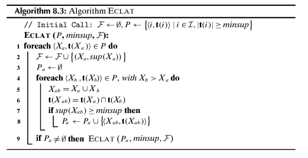

Is all this worth it? If tidsets are sorted lists, one intersection costs at most $O(\lvert D \rvert)$. There can still be exponentially many itemsets to explore, so the work of counting supports is bounded by $O(\lvert D \rvert \cdot 2^{\lvert I \rvert})$. The practical gain is that many intersections involve short lists, and Eclat reuses those lists as it goes deeper.

### FP-growth algorithm

**FP-growth** takes a different approach. It removes infrequent items, puts the remaining items in each transaction in the same global order, and stores the transactions in an **FP-tree**. Transactions with the same prefix share a path, with counts on the nodes.

To grow a pattern, FP-growth takes the prefix paths that lead to a chosen suffix and keeps their counts. These paths form a *conditional pattern base*: a smaller database telling us which items occur with that suffix. The algorithm mines this smaller database recursively and appends the suffix to the resulting patterns. This lets it find frequent itemsets without building Apriori-style candidate lists.

---

Once we have the frequent itemsets, we can generate association rules. For each frequent $Z$ with at least two items, take a nonempty proper subset $X$ and set $Y=Z\setminus X$. Keep $X\Rightarrow Y$ if $\operatorname{sup}(Z)/\operatorname{sup}(X)$ meets the confidence threshold.

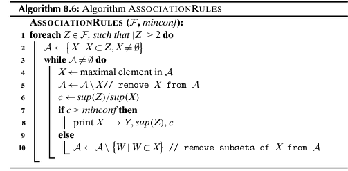

For a fixed $Z$, there’s a useful shortcut. If an antecedent $X$ fails the confidence threshold, then any smaller nonempty antecedent $W\subsetneq X$ also fails. The numerator stays $\operatorname{sup}(Z)$, while the denominator $\operatorname{sup}(W)$ can only grow. So we can check larger antecedents first and prune their subsets when a rule fails.

## Summarizing itemsets

The number of frequent itemsets can grow exponentially with the number of items. Can we store a smaller collection and still recover what we need? That depends on whether we want to know which itemsets are frequent or also recover their exact supports.

### Maximal and closed frequent itemsets

Let $\mathcal F$ be the set of all frequent itemsets:

$$
\mathcal F=\{X\subseteq I:\operatorname{sup}(X)\geq\operatorname{minsup}\}.
$$

#### Maximal frequent itemsets

A frequent itemset is **maximal** if no proper superset is frequent. With $\operatorname{minsup}=3$, the nonempty frequent itemsets in our example are:

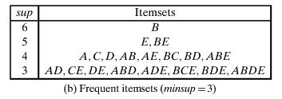

The only maximal frequent itemsets are `ABDE` and `BCE`. Every other frequent itemset is a subset of at least one of these. For example, we know `BD` is frequent because it is a subset of `ABDE`. The maximal itemsets tell us which patterns are frequent, but they don’t tell us the exact support of `BD`.

#### Closed frequent itemsets

An itemset $X$ is **closed** if no proper superset has the same support:

$$
X\text{ is closed}\quad\Longleftrightarrow\quad
\operatorname{sup}(Y)<\operatorname{sup}(X)
\quad\text{for every }Y\supsetneq X.
$$

For example, $\operatorname{sup}(A)=\operatorname{sup}(AB)=4$, so `A` isn’t closed. Neither is `AB`, because `ABE` also has support $4$. But `ABE` is closed: neither adding $C$ nor adding $D$ preserves its support.

Another way to see this is to use the **closure operator**. Let’s go back to our transactions.

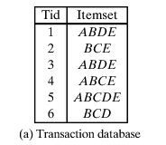

We already know $t(X)$, which returns the transactions containing $X$. We can also go in the other direction: given a set of transaction IDs $T$, let $i(T)$ be the items common to every transaction in $T$. For example, $t(AB)=\{1,3,4,5\}$ and $i(\{2,4\})=\{B,C,E\}$.

Combining these operations gives $c(X)=i(t(X))$. For $A$, we find $t(A)=\{1,3,4,5\}$, and those four transactions have $A$, $B$, and $E$ in common. So $c(A)=\{A,B,E\}$. A closed itemset is one for which $c(X)=X$.

Why do we care about closed frequent itemsets? Because we can recover the support of every frequent itemset from them. If $\mathcal C$ is the collection of closed frequent itemsets, then for any frequent $X$:

$$
\operatorname{sup}(X)
=\max_{\substack{Z\in\mathcal C\\X\subseteq Z}}\operatorname{sup}(Z).
$$

Every superset of $X$ has support at most that of $X$, and the closure of $X$ is a closed superset with exactly the same support. That’s why the maximum gives us the right answer.

As a separate example, suppose the nonempty closed frequent itemsets are:

| Closed itemset | Support |
| --- | ---: |
| `AB` | 4 |
| `ABC` | 2 |
| `D` | 2 |

The closed itemsets containing $A$ are `AB` and `ABC`. Taking the maximum of their supports gives $\operatorname{sup}(A)=\max(4,2)=4$.

#### Minimal generators

A frequent itemset $X$ is a **minimal generator** if no proper subset of $X$ has the same support. Equivalently, all its proper subsets have strictly higher support:

$$
\operatorname{sup}(X)<\operatorname{sup}(Y)
\quad\text{for every }Y\subsetneq X.
$$

So a closed itemset cannot gain an item without losing support, while a minimal generator cannot drop an item without gaining support.

*References: [Chapter 8 — Itemset Mining](https://dataminingbook.info/book_html/chap8/book.html), [Chapter 9 — Summarizing Itemsets](https://dataminingbook.info/book_html/chap9/book.html), and [Han, Pei, and Yin on FP-growth](https://doi.org/10.1023/B:DAMI.0000005258.31418.83).*

