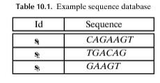
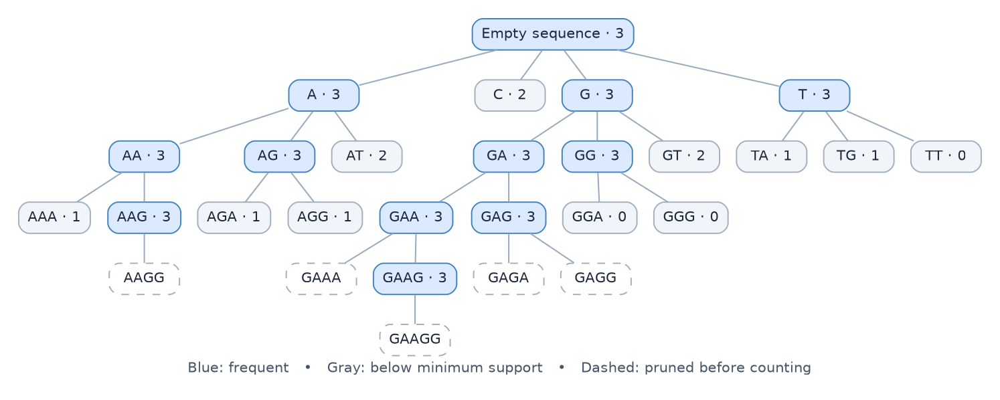
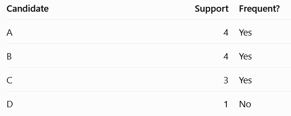
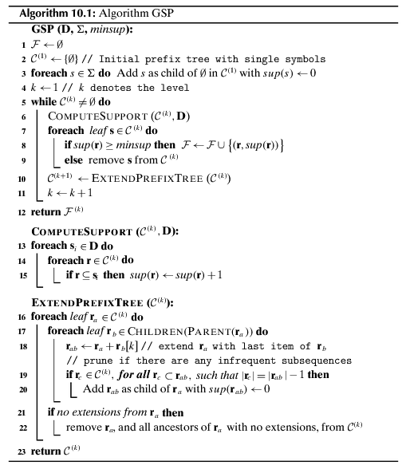

This is the second post in my series revisiting [*Data Mining and Machine Learning*](https://dataminingbook.info/) by Mohammed J. Zaki and Wagner Meira, Jr. This time, I’m looking at [sequence mining](https://dataminingbook.info/book_html/chap10/book.html).

## What is sequence mining?

Many applications, such as text mining, deal with data where order matters. Sequence mining helps us find patterns that recur across time or positions in a dataset.

### Frequent sequences

Let’s call $\Sigma$ an **alphabet**: a finite set of characters or symbols.

A **sequence** is an ordered list of symbols. We write it as $s=s_1s_2\ldots s_n$, where $s_i$ is the symbol at position $i$. A sequence of length $k$ is also called a $k$-sequence.

Let’s introduce some notation. Positions start at $1$, and both endpoints are included:

- **Substring:** $s[i:j]=s_i s_{i+1}\ldots s_j$.
- **Prefix:** $s[1:i]=s_1s_2\ldots s_i$.
- **Suffix:** $s[i:n]=s_i s_{i+1}\ldots s_n$.
- **All sequences over the alphabet:** $\Sigma^*$, including the empty sequence.

Let $s=s_1s_2\ldots s_n$ and $r=r_1r_2\ldots r_m$ be two sequences over $\Sigma$. We say that $r$ is a **subsequence** of $s$, written $r\sqsubseteq s$, if we can match every symbol in $r$ to a position in $s$ while preserving order. More formally, there is a strictly increasing mapping $\phi:\{1,\ldots,m\}\to\{1,\ldots,n\}$ such that $r_i=s_{\phi(i)}$ for every $i$.

A subsequence can skip symbols. If the matched positions are consecutive, then $r$ is a **substring** of $s$: for some starting position $j$, we have $r=s_j s_{j+1}\ldots s_{j+m-1}$.

For example, let $\Sigma=\{A,C,G,T\}$ and $s=\texttt{ACTGAACG}$:

- $\texttt{CGAAG}$ is a subsequence: it matches positions $2,4,5,6,8$.
- $\texttt{CTGA}$ is a substring: it matches positions $2$ through $5$.
- $\texttt{ACT}$ and $\texttt{ACTGA}$ are both prefixes.
- $\texttt{GAACG}$ is a suffix.

Given a database $D$ with $N$ sequence records, the **support** of $r$, written $\operatorname{sup}(r)$, is the number of records that contain $r$ as a subsequence. Each record counts once, even if $r$ occurs in it several times. The **relative support** is the fraction of records that contain $r$:

$$
\operatorname{rsup}(r)=\frac{\operatorname{sup}(r)}{N}.
$$

A sequence is **frequent** if its support meets the chosen minimum, $\operatorname{minsup}$.

### Mining frequent sequences

In sequence mining, the order of the symbols matters. We can also repeat symbols, so $\texttt{AB}$, $\texttt{BA}$, and $\texttt{AA}$ are all possible candidates.

We can organize the search space as a **prefix tree**. At level $0$, the root represents the empty sequence, and each symbol in $\Sigma$ is one of its children. A node at level $k$ represents a sequence of length $k$. To reach one of its children, we append one symbol to the end.

Here’s the example database from Chapter 10, with $\operatorname{minsup}=3$:

The number beside each counted candidate is its support. For example, $\texttt{AA}$ appears as a subsequence in all three records, so it is frequent. $\texttt{C}$ appears in just two records, so we can stop exploring that branch. Extending a sequence cannot increase its support.

#### Level-wise mining: GSP

**GSP** stands for *Generalized Sequential Pattern*. Like Apriori, it searches level by level. The difference is what we’re looking for: in itemset mining, $\{A,B\}=\{B,A\}$, but in sequence mining, $\texttt{AB}\neq\texttt{BA}$.

1. **Find frequent sequences of length 1.** Start with the individual symbols and count how many database records contain each one. In a separate example, suppose the minimum support is $2$ and we get these counts:

   

   We discard $\texttt{D}$, leaving $F^{(1)}=\{A,B,C\}$.

2. **Generate the next level of candidates.** At length $2$, combine the frequent symbols in every order, allowing repeats. At later levels, the prefix-tree version joins two frequent sequences of length $k$ that share their first $k-1$ symbols. Append the last symbol of the second sequence to the first. The two sequences can be the same.

3. **Prune, count, and repeat.** Before counting a candidate of length $k+1$, delete each of its symbols in turn. If any resulting sequence of length $k$ is infrequent, discard the candidate: any record containing the candidate would also contain that shorter sequence. Count the support of the remaining candidates, keep those that meet $\operatorname{minsup}$, and move to the next level. Stop when there are no more candidates.

Back in the prefix tree, $\texttt{GAA}$ and $\texttt{GAG}$ share the prefix $\texttt{GA}$, so they can generate $\texttt{GAAG}$. Its distinct length-three subsequences are $\texttt{AAG}$, $\texttt{GAG}$, and $\texttt{GAA}$. All three are frequent, so $\texttt{GAAG}$ survives pruning. We then count its support and find that it appears in all three database records.

