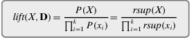
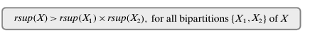
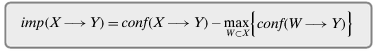

This is the third post in my series revisiting [*Data Mining and Machine Learning*](https://dataminingbook.info/) by Mohammed J. Zaki and Wagner Meira, Jr. In the previous posts, we looked at how to find frequent patterns and association rules. Now that we have those patterns and rules, how do we tell which ones are interesting?

## Rule assessment measures

Remember that an **association rule** has the form $X\to Y$, where $X$ and $Y$ are disjoint, nonempty itemsets. We call $X$ the **antecedent** and $Y$ the **consequent**.

I’ll write $XY$ as shorthand for $X\cup Y$, and $t(X)$ for the set of transactions containing $X$. When I write $P(X)$, I mean the probability that a transaction picked uniformly from the database contains $X$. So $P(XY)$ is the probability that it contains both $X$ and $Y$.

### Support

The **support** of a rule is the number of transactions that contain both $X$ and $Y$:

$$
\operatorname{sup}(X\to Y)=\operatorname{sup}(XY)=|t(XY)|.
$$

The **relative support** is the fraction of all transactions that contain both:

$$
\operatorname{rsup}(X\to Y)=\operatorname{rsup}(XY)=\frac{\operatorname{sup}(XY)}{|D|}.
$$

### Confidence

The **confidence** of a rule answers this question: if a transaction contains $X$, how often does it also contain $Y$?

$$
\operatorname{conf}(X\to Y)=P(Y\mid X)
=\frac{\operatorname{sup}(XY)}{\operatorname{sup}(X)}.
$$

### Lift

Here’s a measure we haven’t seen yet. **Lift** compares how often $X$ and $Y$ occur together with how often we would expect them to occur together if they were independent:

$$
\operatorname{lift}(X\to Y)
=\frac{P(XY)}{P(X)P(Y)}
=\frac{\operatorname{rsup}(XY)}
{\operatorname{rsup}(X)\operatorname{rsup}(Y)}.
$$

How do we use it? If lift is close to $1$, the observed co-occurrence is close to what we’d expect from the individual supports. Values well above $1$ tell us that $X$ and $Y$ occur together more often than expected. Values well below $1$ tell us they occur together less often than expected.

### Leverage

**Leverage** uses the same independence baseline, but it takes the difference instead of the ratio:

$$
\operatorname{leverage}(X\to Y)
=P(XY)-P(X)P(Y)
=\operatorname{rsup}(XY)
-\operatorname{rsup}(X)\operatorname{rsup}(Y).
$$

I find it useful to read leverage alongside lift. Lift tells us how many times larger or smaller the observed probability is; leverage tells us how large that gap is in absolute terms. A rare pair can have high lift and still account for only a small fraction of transactions.

### Jaccard

The **Jaccard coefficient** measures how much two sets overlap. Here, the sets are the transactions containing $X$ and the transactions containing $Y$:

$$
\operatorname{Jaccard}(X\to Y)
=\frac{|t(X)\cap t(Y)|}{|t(X)\cup t(Y)|}
=\frac{\operatorname{sup}(XY)}
{\operatorname{sup}(X)+\operatorname{sup}(Y)-\operatorname{sup}(XY)}.
$$

Of the transactions that contain at least one of the two itemsets, Jaccard tells us what fraction contain both.

### Conviction

Let’s introduce $\neg Y$, the event that a transaction does not contain the whole itemset $Y$. Then $X\neg Y$ means that the transaction contains $X$ but does not contain $Y$. These are the cases where the rule fails.

**Conviction** compares how often we would expect the rule to fail under independence with how often it actually fails:

$$
\operatorname{conv}(X\to Y)
=\frac{P(X)P(\neg Y)}{P(X\neg Y)}
=\frac{1}{\operatorname{lift}(X\to\neg Y)}
=\frac{1-\operatorname{rsup}(Y)}{1-\operatorname{conf}(X\to Y)}.
$$

A conviction above $1$ means the rule fails less often than we’d expect under independence. If the rule never fails and the expected failure probability is positive, conviction is infinite.

### Odds ratio

Let’s first look at the **odds** of finding $Y$ in two groups of transactions: those that contain $X$ and those that don’t.

$$
\operatorname{odds}(Y\mid X)=\frac{P(XY)}{P(X\neg Y)},
\qquad
\operatorname{odds}(Y\mid\neg X)=\frac{P(\neg X\,Y)}{P(\neg X\,\neg Y)}.
$$

The **odds ratio** compares these two odds:

$$
\operatorname{OR}(X\to Y)
=\frac{\operatorname{odds}(Y\mid X)}{\operatorname{odds}(Y\mid\neg X)}
=\frac{\operatorname{sup}(XY)\,\operatorname{sup}(\neg X\,\neg Y)}
{\operatorname{sup}(X\neg Y)\,\operatorname{sup}(\neg X\,Y)}.
$$

Here, support applied to an event counts the transactions in that group. An odds ratio above $1$ means the odds of finding $Y$ are higher in the group containing $X$. Below $1$, the odds are higher in the group without $X$.

## Pattern assessment measures

### Support

As we saw earlier, the **support** of an itemset $X$ is the count of transactions containing it. Divide by the database size to get the **relative support**:

$$
\operatorname{sup}(X)=|t(X)|,
\qquad
\operatorname{rsup}(X)=\frac{|t(X)|}{|D|}.
$$

### Lift

We can also define lift for an entire itemset. Let $X=\{x_1,x_2,\ldots,x_k\}$. Its lift in $D$ is:

$$
\operatorname{lift}(X,D)
=\frac{P(X)}{\prod_{i=1}^{k}P(\{x_i\})}
=\frac{\operatorname{rsup}(X)}
{\prod_{i=1}^{k}\operatorname{rsup}(\{x_i\})}.
$$

This compares the probability of seeing all the items together with what we’d expect if the individual items were mutually independent.

### Rule-based measures

Another way to assess an itemset is to look at the rules we can generate from it. Split $X$ into two nonempty, disjoint parts $X_1$ and $X_2$. Each such split gives us two rules: $X_1\to X_2$ and $X_2\to X_1$.

Compute a rule assessment measure for each of these rules, then summarize the results with a statistic such as the mean, maximum, or minimum. For instance, the minimum tells us how the weakest rule scores on that measure.

## Comparing multiple rules and patterns

### Comparing itemsets

#### Maximal itemsets

A frequent itemset $X$ is **maximal** if no strict superset of $X$ is frequent. In other words:

$$
\operatorname{sup}(X)\geq\operatorname{minsup},
\qquad
\operatorname{sup}(Y)<\operatorname{minsup}
\quad\text{for every }Y\supsetneq X.
$$

If we have a long list of frequent itemsets, we may choose to keep only the maximal ones.

#### Productive itemsets

An itemset $X$ with at least two items is **productive** if it occurs more often than expected under independence for every split into two nonempty parts:

The product $\operatorname{rsup}(X_1)\operatorname{rsup}(X_2)$ is the expected co-occurrence under independence. The key word is *every*: one split with lift greater than $1$ isn’t enough.

### Comparing rules

Suppose two rules, $R:X\to Y$ and $R':W\to Y$, have the same consequent. If $W$ is a proper subset of $X$, then $R$ is **more specific** and $R'$ is **more general**: $R'$ asks for fewer items on the left-hand side.

#### Nonredundant rules

A rule $R$ is **redundant** if a more general rule $R'$ has the same support. Dropping the extra conditions leaves the same set of transactions supporting the rule.

If $\operatorname{sup}(R)<\operatorname{sup}(R')$ for every more general rule $R'$, then $R$ is **nonredundant**.

#### Improvement and productive rules

Does adding conditions to the antecedent actually improve confidence? **Improvement** compares the confidence of $X\to Y$ with the highest confidence among its more general rules:

In the formula, $W$ ranges over proper subsets of $X$. We compare rules with nonempty antecedents, so this calculation applies when there’s at least one such generalization. A rule is **productive** when its improvement is positive: the more specific rule has higher confidence than every more general rule with the same consequent.

*Reference: [Chapter 12 — Pattern and Rule Assessment](https://dataminingbook.info/book_html/chap12/book.html).*

