## Unsupervised Learning: Word Embeddings

How can we represent a word as a vector? This is the question behind **word embeddings**.

Imagine we have a dataset $D=\{\mathbf{x}_1,\ldots,\mathbf{x}_n\}$. As we saw before, unsupervised learning looks for regularities in the data and uses them to build a representation that can help us make predictions or reason about the data. I used clustering as an example. Today we'll look at what it means to learn a representation with neural networks.

### Neural Autoencoder

An **autoencoder** is a neural network trained to reconstruct its input: the target is the input itself.

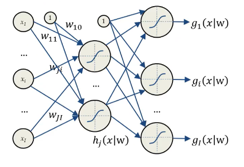

Why would we use a neural network to learn the identity function? The key is what happens in the middle. If the hidden representation has fewer dimensions than the input, the encoder has to compress the input. The decoder then uses that compressed representation to reconstruct the input as closely as possible.

$$
\mathbf{x}\in\mathbb{R}^{I}
\xrightarrow{\text{encoder}}\mathbf{h}\in\mathbb{R}^{J}
\xrightarrow{\text{decoder}}\widehat{\mathbf{x}}\in\mathbb{R}^{I},
\qquad J\ll I.
$$

Sometimes we also want the representation to be **sparse**: for a given input, only a few hidden units should be active.

If you've read about PCA, this might sound familiar. Both methods try to preserve enough information to reconstruct the input from a smaller representation. PCA finds a linear subspace. An autoencoder with nonlinear layers can capture structure that a linear projection misses. That's why I like to think of it as a nonlinear counterpart to PCA.

We can express what we want the network to learn in its loss function:

$$
E(\mathbf{x})=
\underbrace{\|\widehat{\mathbf{x}}-\mathbf{x}\|_2^2}_{\text{reconstruction error}}
+\lambda\underbrace{\sum_{j=1}^{J}\lvert h_j\rvert}_{\text{sparsity penalty}}.
$$

Here, $h_j$ is the activation of hidden unit $j$. The first term measures how far the reconstruction is from the input. The second penalizes the magnitude of the hidden activations, and $\lambda$ controls how much that penalty matters. If different groups of inputs activate different units, the result can look a little like clustering. Sparsity alone doesn't guarantee a one-hot code, though. A penalty that's too strong can simply drive most activations toward zero and hurt reconstruction.

What does this have to do with word embeddings? The connection is the idea of learning a useful representation in fewer dimensions.

Suppose our vocabulary assigns a different ID to each word: *cat* is ID 547, *dog* is ID 768, and so on. In a **one-hot encoding**, each word has a vector with a single 1 at its own index. A large vocabulary therefore gives us long, sparse vectors.

The other problem is similarity. Suppose I encode *Rome* as $[0,1,0,0,0]$, *capital* as $[1,0,0,0,0]$, and *porridge* as $[0,0,1,0,0]$. In this representation, *capital* and *porridge* are equally far from *Rome*. The vectors tell us which word is which, but their distances tell us nothing about how the words are related.

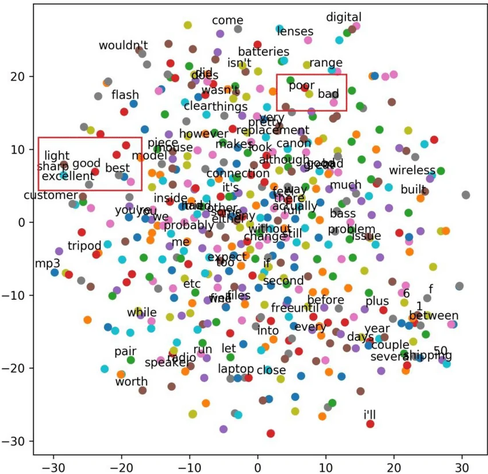

A **word embedding** maps each word in a vocabulary $V$ to a vector of real numbers. The embedding dimension $m$ is usually far smaller than the vocabulary size, often a few hundred. In a learned embedding space, nearby vectors can represent words that occur in similar contexts or have related meanings.

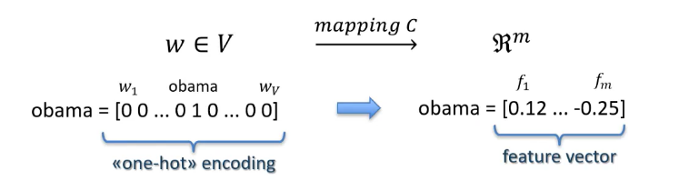

This gives us three things:

- **Compression:** the vector has far fewer dimensions than the vocabulary.
- **A continuous representation:** the entries are real numbers, so distances and directions can carry information.
- **A denser representation:** information about a word can be spread across several entries.

How do we learn these vectors? Let's start with a **language model**: a model that assigns probabilities to sequences of words.

The probability of a sentence is the probability of its first word, multiplied by the probability of the second word given the first, and so on. Each word is conditioned on all the words before it.

$$
P(s)=P(w_1,\ldots,w_k)
=\prod_{i=1}^{k}P(w_i\mid w_1,\ldots,w_{i-1}).
$$

Here, $k$ is the number of words, and the first factor is simply $P(w_1)$. This factorization is exact. The difficulty is estimating all those probabilities: with a large vocabulary and long sentences, there are far too many possible histories to learn a separate estimate for each one.

An **$n$-gram model** makes the problem smaller by looking back only at the previous $n-1$ words. A trigram model, for example, looks back at two. This makes estimation more manageable, but the model misses information that appears earlier in the sentence.

### Neural Network Language Model

In their [2003 paper](https://www.jmlr.org/papers/volume3/bengio03a/bengio03a.pdf), Yoshua Bengio and his coauthors used a neural network to learn word representations and predict the next word. What was the idea?

We still start with a fixed window of $n-1$ words. Instead of passing long one-hot vectors through the network, we use each word's ID to look up its embedding. We concatenate the $n-1$ vectors to get an input of length $(n-1)m$. This goes through a hidden layer with a $\tanh$ activation. A softmax then gives us a probability for each possible next word.

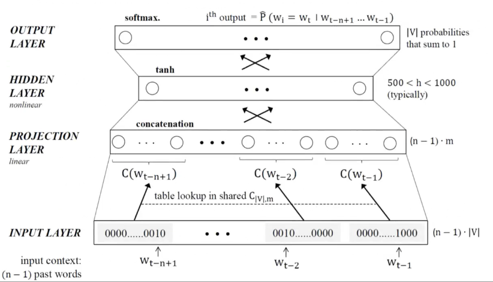

We train the model using stochastic gradient descent. In the architecture shown here, with $h$ hidden units, the hidden layer costs roughly $(n-1)mh$ operations per example, and the full output layer adds a cost proportional to $h\lvert V\rvert$. That output layer gets expensive as the vocabulary grows. The model can share what it learns across words with similar embeddings, although rare words still provide fewer examples to learn from.

### Google's word2vec

In [a 2013 paper](https://arxiv.org/abs/1301.3781), Tomas Mikolov and his coauthors proposed simpler architectures that could learn word embeddings from much more data. They removed the nonlinear hidden layer and used words on both sides of a target word as its context. The same input embedding table is used at each context position, and the output weights are learned separately.

They proposed two architectures:

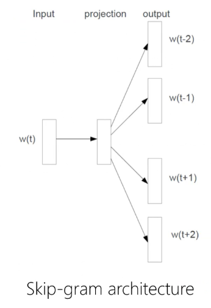

In **skip-gram**, we take a center word and use its embedding to predict the surrounding words. In **continuous bag-of-words** (CBOW), we do the reverse: we use the surrounding words to predict the center word. Let's look at CBOW first.

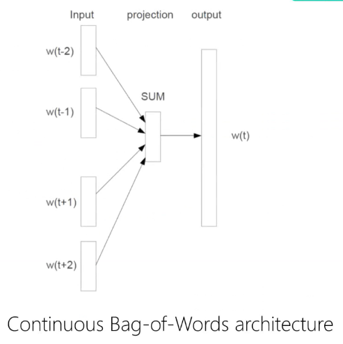

Notice that the context vectors are added together rather than concatenated. The version shown below averages them, which is just the sum divided by the number of context words. Either way, the combined vector is the same size as a single embedding, and the order of the context words doesn't affect it.

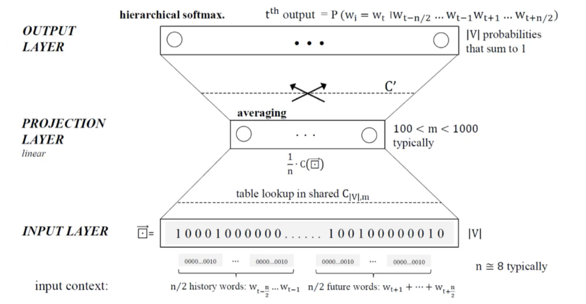

This makes the model cheaper to train. If there are $c$ context words, combining their vectors costs $O(cm)$. With hierarchical softmax, scoring the target word follows one path in a tree instead of scoring every word in the vocabulary. For a balanced tree, that part costs $O(m\log\lvert V\rvert)$.

Here's the part I find most interesting. Some relationships show up as similar directions in the embedding space. In this projection, for example, the lines from countries to their capitals tend to point in similar directions.

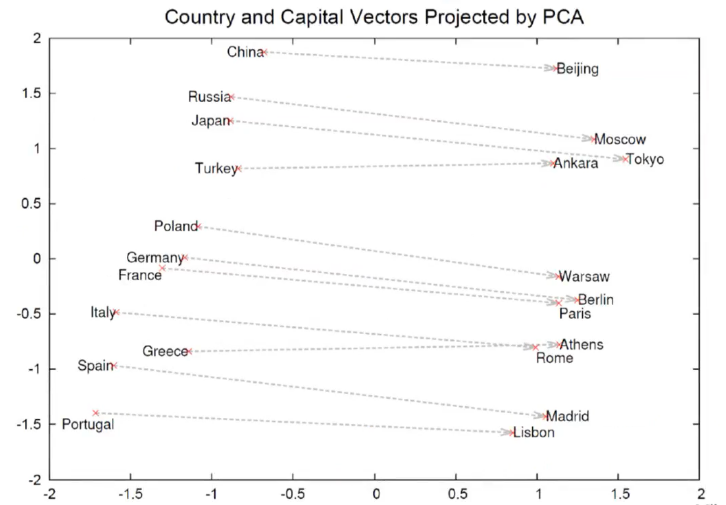

We can even try vector operations such as:

$$
\mathbf{w}_{\text{king}}-\mathbf{w}_{\text{man}}+\mathbf{w}_{\text{woman}}
\approx \mathbf{w}_{\text{queen}}.
$$

What exactly is $\mathbf{w}_{\text{king}}$? Let's walk through skip-gram:

1. Take a center word such as *king*.
2. Represent it as a one-hot vector.
3. Multiply that row vector by the embedding matrix $W$. The one-hot vector selects the row for *king*, which is $\mathbf{w}_{\text{king}}$.
4. Use a separate set of output weights to score the context.
5. Compute the loss using the observed context words and update the relevant weights through backpropagation.

So $W$ is the table of input embeddings, and $\mathbf{w}_{\text{king}}$ is one row of that table. The training signal comes from the text itself. This is usually called **self-supervised learning**, and it illustrates the idea we started with: using regularities in the data to learn a representation.

## Sequence-to-Sequence Learning 101

A **sequence-to-sequence** model takes one sequence and produces another. The two sequences can have different lengths. Here we'll look at the classic recurrent encoder–decoder, which can be built with RNNs or LSTMs.

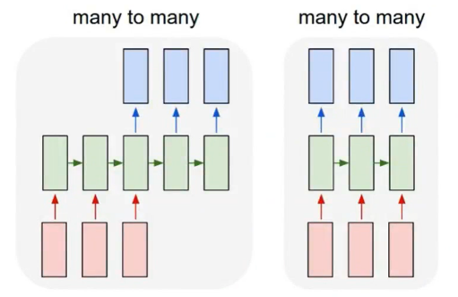

Given an input sequence $x=(x_1,\ldots,x_m)$, we want to find the output sequence $y=(y_1,\ldots,y_n)$ that is most probable given $x$.

$$
y^*=\operatorname*{arg\,max}_{y}P(y\mid x).
$$

We don't know the true conditional distribution, so we learn a model $P(y\mid x,\theta)$ from pairs of input and output sequences. We then search for an output that maximizes the probability assigned by the model.

$$
\widehat{y}=\operatorname*{arg\,max}_{y}P_{\theta}(y\mid x).
$$

We can think of the model that assigns these probabilities as a **conditional language model**.

### Conditional Language Models

A language model assigns a probability to a sequence. In the models we're looking at, each next token is predicted from the tokens that precede it. We write $y_{<t}$ for the prefix $(y_1,\ldots,y_{t-1})$.

$$
P(y_1,\ldots,y_n)=\prod_{t=1}^{n}P(y_t\mid y_{<t}).
$$

A conditional language model also sees a source $x$. In translation, $x$ is the sentence we want to translate. At each step, the model predicts the next target token using both the source sentence and the target tokens already available.

$$
P(y_1,\ldots,y_n\mid x)=\prod_{t=1}^{n}P(y_t\mid y_{<t},x).
$$

What does *conditioned on the source* mean in practice? Imagine the English translation begins with “I saw a”. Without the source, both *cat* and *dog* might be plausible next words. If the Russian sentence mentions a cat, the source gives the model a reason to assign *cat* a higher probability. With a different source, the same English prefix could lead to a different next word. In other tasks, the context might be an image or a label.

Think about what happens in human translation: a translator reads the source and uses their judgment to choose a translation. The equation uses probability as a way to express that intuition: $P(y\mid x)$ stands for how plausible the translation seems to the translator.

$$
y^*=\operatorname*{arg\,max}_{y}P(y\mid x).
$$

In machine translation, the model uses its learned parameters $\theta$ to score possible outputs.

$$
\widehat{y}=\operatorname*{arg\,max}_{y}P_{\theta}(y\mid x).
$$

That leaves three questions: What does the model look like? How do we learn $\theta$? And how do we find the best output sequence?

### Encoder–Decoder Framework

The **encoder** reads the source sentence and builds a representation of it. The **decoder** uses that representation to generate the target sentence, one token at a time.

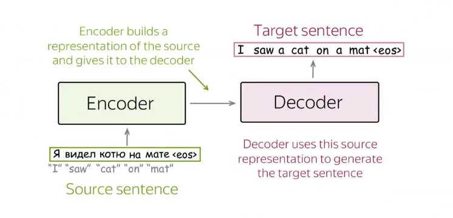

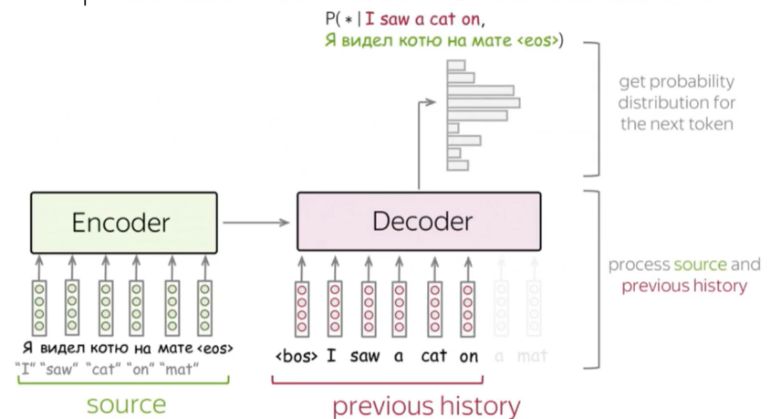

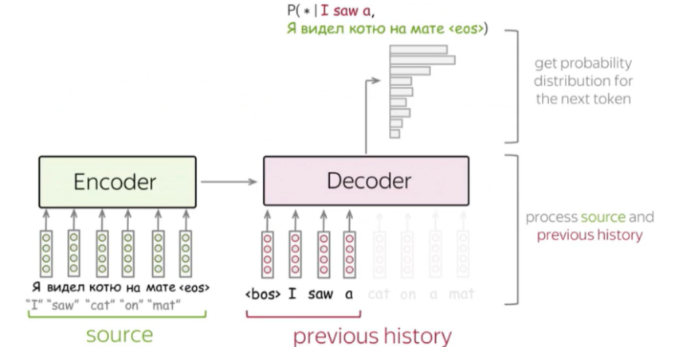

Remember the two things a conditional language model uses to predict the next word: the source and the target prefix. In this architecture, the encoder supplies information about the Russian sentence, and the decoder tracks the English words it has received so far. A softmax converts its scores into a probability distribution over the next token.

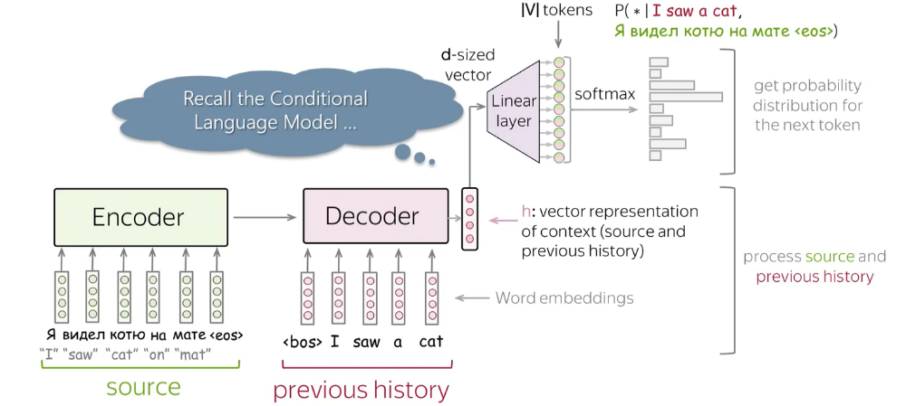

In the recurrent version shown here, the encoder reads the source one token at a time. Its final state initializes the decoder, which then reads the target prefix one token at a time.

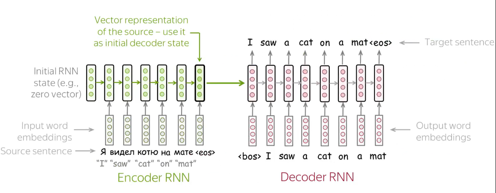

How do we train this?

Suppose we have a training pair $(x,y)$. The source sequence $x=(x_1,\ldots,x_m)$ is in Russian, and the target sequence $y=(y_1,\ldots,y_n)$ is its English translation.

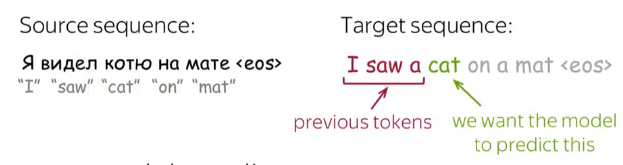

At step $t$, the model predicts a probability distribution over the target vocabulary. It uses the source $x$ and the earlier target tokens $y_1,\ldots,y_{t-1}$.

$$
p_t(v)=P_{\theta}(y_t=v\mid y_{<t},x),\qquad v\in V.
$$

Suppose the decoder has received “I saw a”, and the next word in the training translation is *cat*. To keep the example small, imagine the vocabulary contains only these five words:

| Token | Predicted probability |
| --- | ---: |
| dog | 0.10 |
| cat | 0.60 |
| bird | 0.15 |
| car | 0.10 |
| house | 0.05 |

In this order, the predicted distribution is $[0.10,0.60,0.15,0.10,0.05]$, and the one-hot target $q_t$ is $[0,1,0,0,0]$.

We use **cross-entropy** to compare them.

$$
\operatorname{loss}_t
=-\sum_{v\in V}q_t(v)\log p_t(v),
$$

The only nonzero entry in the target is the one for *cat*. That leaves:

$$
\operatorname{loss}_t=-\log(0.60)\approx 0.511.
$$

So at each step, we take the negative logarithm of the probability assigned to the correct token. Over the entire sequence, we add the losses from all the prediction steps.

$$
\operatorname{loss}(x,y)
=\sum_{t=1}^{n}\operatorname{loss}_t
=-\sum_{t=1}^{n}\log P_{\theta}(y_t\mid y_{<t},x).
$$

Where do the previous target tokens come from during training? In this setup, we use **teacher forcing**: at each step, the decoder receives the previous token from the training translation. It starts with a beginning-of-sequence token.

Suppose the target is:

> &lt;bos&gt; I saw a cat &lt;eos&gt;

If the decoder predicts *see* instead of *saw* at step 2, it still receives *saw* at step 3. The prediction *see* affects the loss at step 2, but it isn't passed on as the next input.

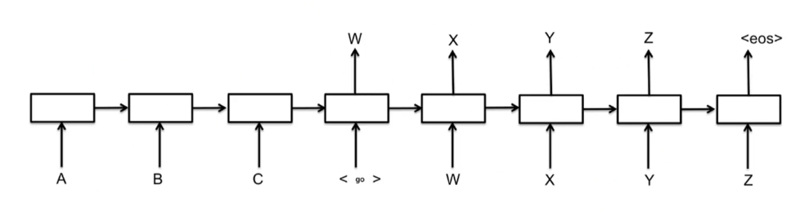

At inference time, we don't have a reference translation. The decoder starts with &lt;bos&gt;, then feeds the token it selected back in to predict the next one. Generation can stop when it selects &lt;eos&gt;.

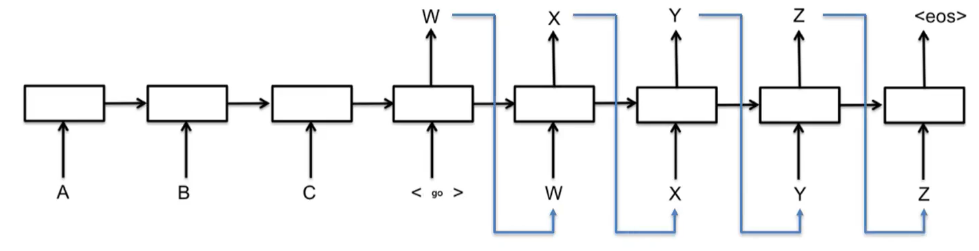

Once we've learned $\theta$, our goal is to find the output sequence with the highest probability under the model. Its score comes from multiplying the probabilities of its tokens, each conditioned on the source and on the prefix of that particular sequence.

$$
\widehat{y}
=\operatorname*{arg\,max}_{y}
\prod_{t=1}^{n(y)}P_{\theta}(y_t\mid y_{<t},x),
$$

where $n(y)$ is the number of tokens in candidate sequence $y$, including its end token. Searching every possible sequence gets expensive quickly. We can use two simpler approaches:

1. **Greedy decoding:** pick the most probable token at each step and keep going.

   $$
   \widehat{y}_t
   =\operatorname*{arg\,max}_{v\in V}
   P_{\theta}(y_t=v\mid \widehat{y}_{<t},x).
   $$

   This doesn't guarantee the most probable sequence overall. A token can look best now and lead to less probable continuations later. Greedy decoding never goes back to reconsider an earlier choice.

2. **Beam search:** keep several candidate sequences at once.

   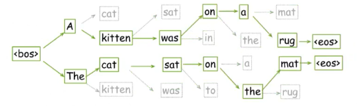

   With a beam width of two, we start by keeping the two best first tokens. At the next step, we score extensions of both prefixes using their cumulative probabilities, then keep the best two extensions across the whole beam. We repeat the process as the sequences grow. This gives us more room to recover from a locally tempting choice, although it still doesn't guarantee the best possible sequence.
