Do you know how a digital image is stored on a computer? An RGB image can be represented as three arrays: one for red, one for green, and one for blue. In a typical 8-bit image, each entry is an integer from 0 to 255 that gives the intensity of one color at one pixel. So every pixel is represented by three numbers.

Even a small image can contain thousands of values. A video stores a whole sequence of frames, so the numbers add up quickly. Luckily, nearby pixels often have similar values, which makes visual data easier to compress.

What can we do with these pixel values?

## Intensity Transformation

An intensity transformation changes each pixel independently:

$$
G(r,c)=T\bigl(I(r,c)\bigr).
$$

Here, $I$ is the input image, $G$ is the output image, and $(r,c)$ is the row and column of the pixel. The function $T$ takes the value at that pixel and returns a new one. For example, to convert RGB to grayscale, we use a function $T:\mathbb{R}^3\to\mathbb{R}$ that maps three color intensities to one.

## Intensity Rescaling

Sometimes we want to map intensities into the range $[0,255]$. If $I_{\min}$ and $I_{\max}$ are the smallest and largest intensities in the input channel, and they're different, we can write:

$$
G(r,c)=255\,\frac{I(r,c)-I_{\min}}{I_{\max}-I_{\min}}.
$$

The smallest intensity becomes 0, the largest becomes 255, and everything in between is rescaled proportionally. This is one option; z-score normalization is another.

## Local (Spatial) Transformations

So far, the output at each pixel has depended only on the input at that same location. A **local transformation** also looks at the pixels around it:

$$
G(r,c)=T_U[I](r,c).
$$

Here, $U$ is the set of offsets that defines the neighborhood. The transformation $T_U$ takes the input values at positions $(r+u,c+v)$ for all $(u,v)\in U$ and uses them to compute the output at $(r,c)$. For an RGB image, the output at each location can be a single number or another RGB triplet.

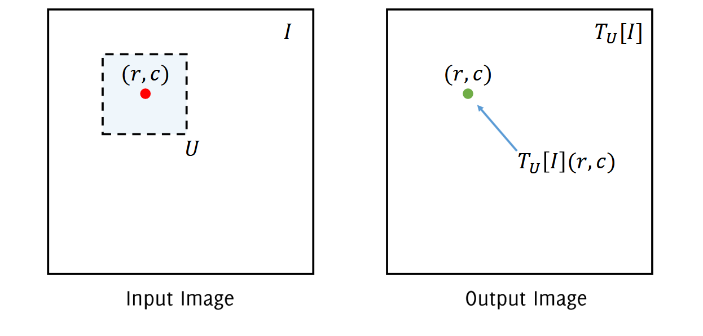

Think of $(u,v)$ as a displacement from the center. For example, $(-1,-1)$ means one row up and one column left, while $(1,0)$ means one row down in the same column.

The first operation that comes to mind is taking the mean of the pixels in the neighborhood. That gives all positions the same fixed weight. How could we make the operation learnable? We can use a **weighted sum** and let the model learn the weights:

$$
T[I](r,c)=\sum_{(u,v)\in U} w(u,v)\,I(r+u,c+v).
$$

The array of weights $w$ is called a **filter**. The figure shows the process from left to right: take a patch of the image, multiply it by the filter entry by entry, and add the products to get one output value.

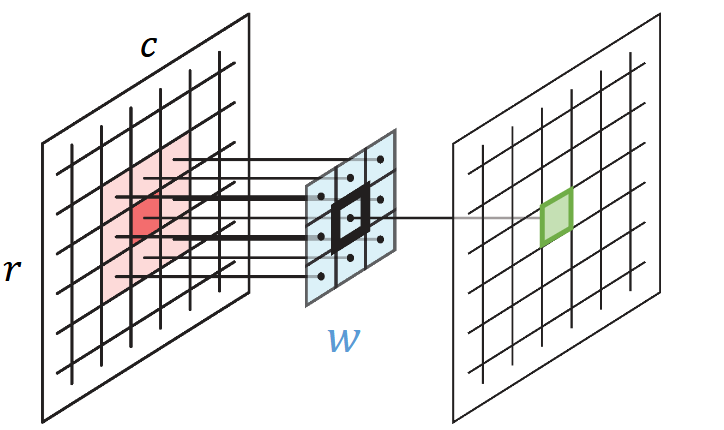

So what do you think will happen if we slide this filter over the image?

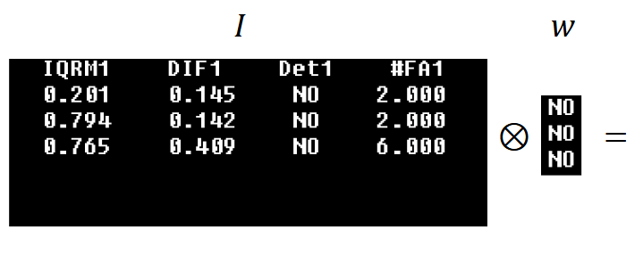

In an entirely black patch, all the input intensities are zero, so the output is zero. The interesting part is what happens when the filter overlaps some white letters.

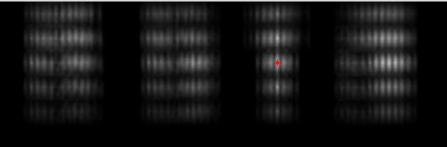

The red dot marks the strongest response. At that location, the white letters in the filter line up with the white letters in the image, so their products add up to a larger value. In this example, a larger response tells us where the patch matches the filter best.

This operation is called **cross-correlation**. The weighted sum above is for a grayscale image. For an RGB image, a filter has a set of weights for each color channel. We compute the sum for each channel and then add the three results:

$$
T[I](r,c)=\sum_{k=1}^{3}\sum_{(u,v)\in U} w(u,v,k)\,I(r+u,c+v,k).
$$

## Image Classification Problem

Now suppose we want to assign a label to an image. A model can give us a probability for each possible class, as in the example below, and use the most probable class as its prediction.

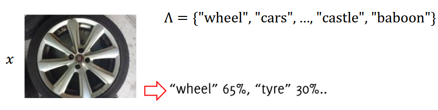

If $\Lambda$ is the set of possible labels, we can write the final prediction as:

$$
I\longmapsto \mathcal{K}_{\theta}(I)\in\Lambda,
$$

where $I$ is the input image and $\theta$ denotes the learned parameters of the classifier.

What is the simplest classifier we could use?

### Linear Classifier

First, we need to turn the image into a vector. We can flatten each color channel column by column, then concatenate the three results. As long as we use the same order for every image, each entry in the vector always represents the same pixel position and color channel.

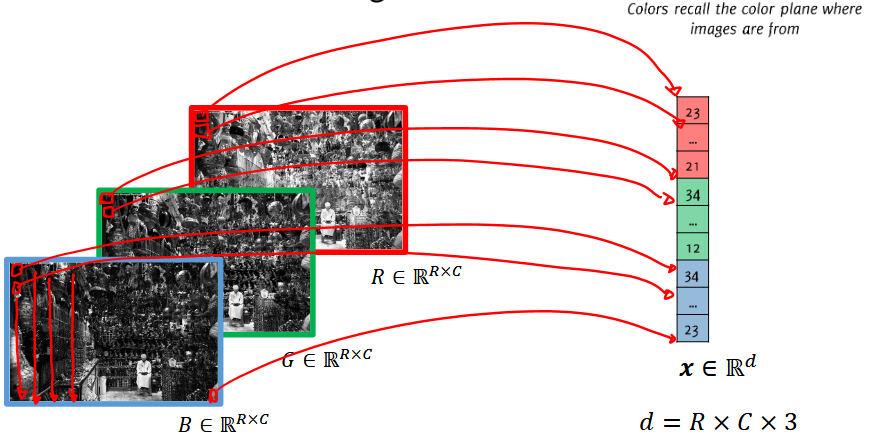

Let's take CIFAR-10 as an example. It has 10 classes, and every image is only $32\times32$ pixels.

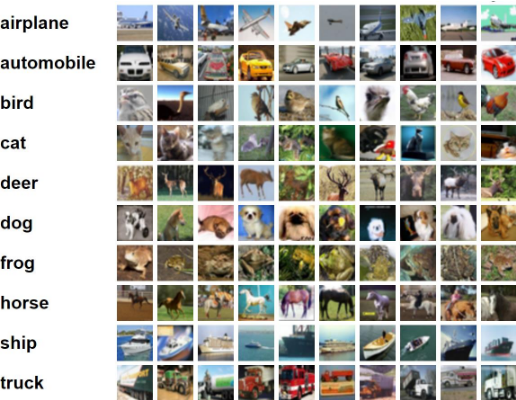

After flattening the three color channels, each image becomes a vector $\mathbf{x}\in\mathbb{R}^{d}$ with $d=32\times32\times3=3072$. Even with images this small, we already have 3,072 input values.

Now let's feed this vector into a network with one layer of learned weights and no hidden layers. It gives us one score per class.

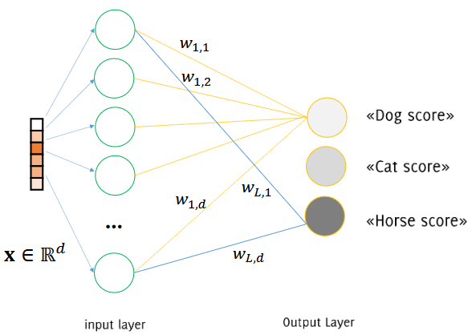

For example, the score for the first class is:

$$
s_1=\sum_{j=1}^{d}w_{1,j}x_j+b_1.
$$

We can apply softmax to turn the scores into probabilities. If we only need the predicted class, we can skip softmax at inference: it preserves the ordering of the scores, so the class with the largest score also has the highest probability.

With $L$ classes, we can arrange all the weights in a matrix $W\in\mathbb{R}^{L\times d}$ and all the biases in a vector $\mathbf{b}\in\mathbb{R}^{L}$. The score for class $i$ is the inner product between row $W[i,:]$ and the image vector, plus the bias for that class:

$$
s_i=W[i,:]\cdot\mathbf{x}+b_i.
$$

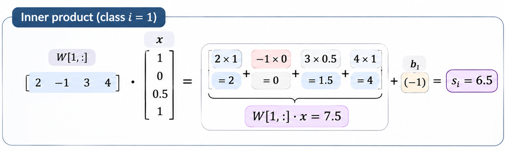

Each weight tells us how a particular input value contributes to the score. A positive weight means that increasing that pixel intensity raises the score, all else being equal; a negative weight means it lowers the score.

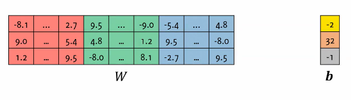

So the network computes $L$ inner products, adds the corresponding biases, and picks the class with the largest score:

$$
\widehat{y}=\operatorname*{arg\,max}_{1\leq i\leq L} s_i.
$$

We can also look at this geometrically. If an input had just two features, the score for one class would be:

$$
f(x_1,x_2)=w_1x_1+w_2x_2+b.
$$

Setting $f(x_1,x_2)=0$ gives a line separating positive scores from negative ones. In higher dimensions, that line becomes a hyperplane. For a multiclass prediction, the boundary between two winning classes lies where their scores are equal, $s_i=s_j$, with neither score below that of another class.

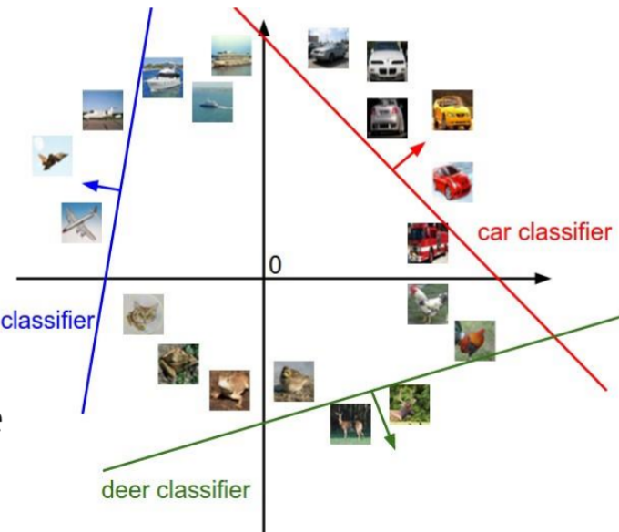

Here are the templates learned by a linear classifier on CIFAR-10:

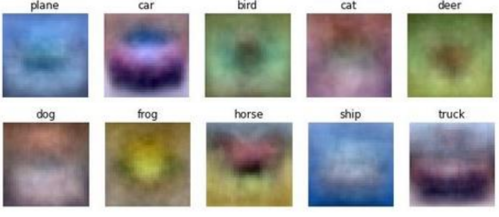

What are we actually looking at? For CIFAR-10, $W\in\mathbb{R}^{10\times3072}$. Each row contains one class's 3,072 weights. If we undo the flattening and reshape a row into a $32\times32\times3$ array, we can visualize it as an image. That's what we mean by a **template** here: it's a picture of the learned weights for a class.

To classify a new image, the model takes its inner product with each template and adds that class's bias. The largest resulting score determines the prediction.

This is a simple starting point. Next, we'll see what changes when we use **convolutional neural networks** and learn filters that can detect the same pattern at different locations.
